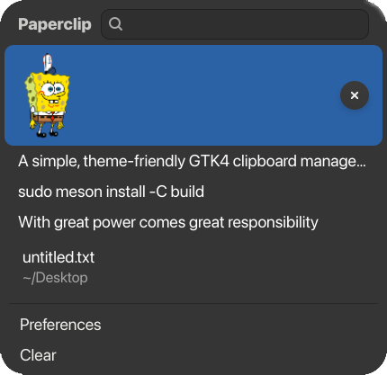
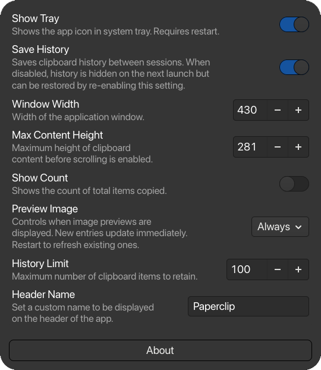
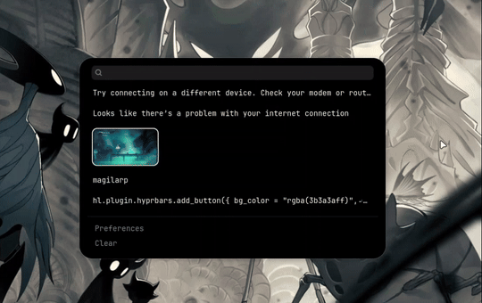

<div align="center">
<picture>
    
</picture>
</div>
<h1 align="center">
Paperclip
</h1>

<div align="center">


[](https://www.gnu.org/licenses/gpl-3.0)
</div>
A simple, theme-friendly GTK4 clipboard manager built with gtk4-rs. Customize the app's appearance using a custom CSS file <a href="#theming">(Theming)</a>.<br><br>

Uses <a href="https://github.com/Decodetalkers/wayland-clipboard-listener">wayland-clipboard-listener</a> to listen to the clipboard in Wayland.<br>

Items marked with `x-kde-passwordManagerHint` MIME type are discarded and never stored in the database or displayed in the app. This means passwords copied from password managers that attach this MIME type are ignored.

**Compatibility**: Currently supports only Wayland compositors that support the ext-data-control-v1 protocol. Gnome is not yet supported, but support is planned.
<hr />

## Preview

<div align="center">
  
  <p><strong>Main Window</strong></p>

  
  <p><strong>Preferences</strong></p>
</div>

### Example CSS Configs

Choose a CSS example from the [examples](docs/css-examples) and copy its contents into `~/.config/paperclip-clipboard/style.css`.

<div align="center">
    
    <p><strong>Monochrome CSS</strong></p>
</div>

## Theming

Paperclip Clipboard supports custom CSS for theming the app. Create a style.css file in the app's configuration directory at `~/.config/paperclip-clipboard/style.css`.

You can target the following CSS classes in your stylesheet:

`.main-box`<br>
`.header-box`<br>
`.header-label`<br>
`.count-label`<br>
`.search-entry`<br>
`.main-listview`<br>
`.row-label`<br>
`.row-image`<br>
`.remove-button`<br>
`.footer-box`<br>
`.footer-button`<br>
`.clear-button`<br>
`.preferences-button`<br>
`.preferences-window`<br>
`.preferences-box`<br>
`.preferences-list`<br>
`.preferences-row`<br>
`.about-button`<br>
`.about-window`<br>
`.about-box`<br>
`.app-icon`<br>

For example, to change the background color of the header:

```css
.header-box {
  background-color: pink;
}
```

<hr />

## Installation

### Download a Release

The easiest way to get this app is to download a prebuilt binary from the <a href="https://github.com/str8edge-dev/paperclip-clipboard/releases/latest">latest release</a>.

## Building

**Prerequisites**: Make sure git, rust, cargo, meson (1.4 or newer), ninja and gtk4 are installed.

1. Clone the repository

   ```shell
   git clone https://github.com/str8edge-dev/paperclip-clipboard.git
   cd paperclip-clipboard
   ```

2. Create a Meson build directory:

   ```shell
   meson setup build
   ```

   For a development build, use:

   ```shell
   meson setup build -Dprofile=development
   ```

3. Run the following command to compile and run the program without installing:

   ```shell
   meson compile -C build
   ./build/target/release/paperclip-clipboard
   ```

   To install the application system-wide:

   ```shell
   sudo meson install -C build
   ```

### Building an Arch Linux Package (or Arch-based distributions)

**Prerequisites**: base-devel, git.

1. Clone the repository

   ```shell
   git clone https://github.com/str8edge-dev/paperclip-clipboard.git
   cd paperclip-clipboard
   ```

2. Build and install

   ```shell
   cd packaging/arch
   makepkg -si
   ```

   To build the package without installing:

   ```shell
   makepkg
   ```

   The package produced can be installed with:

   ```shell
   sudo pacman -U <package-name>
   ```

<hr />

## Contributing

Feel free to open an issue for bug reports or feature suggestions, or submit a pull request with improvements. All contributions are appreciated.
